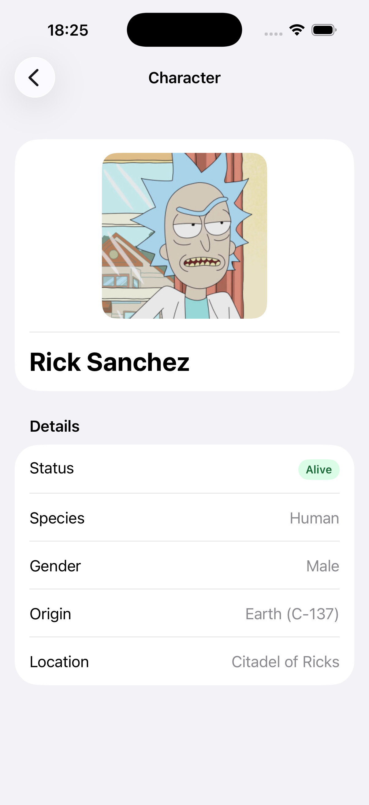

# Rick and Morty iOS

A SwiftUI application consuming the public
[Rick and Morty API](https://rickandmortyapi.com/documentation/), developed as a
Senior iOS technical assessment with an emphasis on testability and concurrency safety.

## Features

- Remote character search with a 300 ms debounce, cancellation of obsolete searches,
  and protection against stale responses updating the UI.
- Character results with cached image thumbnails and pagination driven by API metadata.
- Character details showing name, status, species, gender, origin and location.
- Loading, empty, error and retry states, with existing results preserved on pagination failure.
- In-memory domain caching with a configurable TTL, defaulting to 180 seconds.
- Native navigation, accessibility support and automatic Light/Dark appearance.

## Screenshots

<p align="center">
  
  
</p>

Captured from the running app on an iPhone 17 Pro simulator in Light Mode.

## Tech stack

- iOS 17+, Swift 6 with strict concurrency, SwiftUI and Observation.
- Swift Package Manager, Swift Testing and native URLSession.
- SwiftFormat 0.64.5, SwiftLint 0.65.1 and GitHub Actions.
- No third-party runtime dependencies.

## Architecture

| Target | Responsibility | Dependencies |
| --- | --- | --- |
| Domain | Entities, repository contracts and use cases | Foundation |
| Data | Networking, DTO mapping, repository and in-memory caches | Domain |
| Presentation | SwiftUI views, observable ViewModels and presentation state | Domain |
| App | Entry point and dependency composition | Domain, Data, Presentation |

The three library targets live in `Packages/RickAndMortyKit`, with colocated tests.
MVVM keeps rendering separate from observable UI state; Clean Architecture keeps
business contracts independent of networking and SwiftUI. Separate SPM targets
enforce these dependency boundaries at compilation. The App is the composition root
and supplies concrete dependencies through constructor injection. Domain and Data avoid UI frameworks.
The project is configured for iOS only. SwiftData is intentionally omitted because
the app needs an ephemeral TTL cache, not a persistent object store.

## Key technical decisions

- **Concurrency and cancellation:** MainActor-isolated ViewModels own UI state.
  Searches use cancellable tasks and generation identifiers to reject obsolete
  results. Equivalent queries are trimmed and lowercased before comparison, preventing
  case-only edits from restarting searches. Repository operations also respect cancellation.
- **Domain caching:** Generic actor-isolated `MemoryCache` stores search pages by
  normalized query and page. The repository always returns valid entries without
  networking; missing or expired entries fetch automatically.
  Synchronous injected monotonic time keeps cache operations free of suspension points;
  per-key generation tokens still prevent out-of-order network responses from replacing newer values.
  Failed or cancelled fetches cannot populate the cache.
  Pages expire independently, so a consistent server snapshot across pages is not guaranteed.
- **Networking and images:** URLSession requests decode Data-only DTOs into domain
  models and map infrastructure failures to domain errors, preserving cancellation.
  JSON requests bypass HTTP caching; a separate image session uses URLCache-backed
  HTTP caching. Image retention depends on cache policy and eviction and is not guaranteed.
- **Navigation and state:** Native `NavigationLink` and `NavigationStack` carry the selected
  immutable `Character`. Details display the fields already returned by the list API,
  without another detail request, cache or ViewModel. The App retains the search ViewModel
  with `@State`. Pagination progress and errors remain separate from loaded results.
  Search completion announces accepted results or an empty state to assistive apps;
  stale responses and pagination do not generate announcements. Errors use a small
  concrete Presentation type and equatable view states.
- **Deterministic testing:** Constructor injection, controlled repository/transport
  doubles and injected monotonic time test cancellation, expiration and out-of-order
  completion without real HTTP requests or timing-based sleeps.

## Getting started

Local build and test validation used Xcode 26.4. The CI workflow selects Xcode 26.4.1.

1. Open `RickAndMorty.xcodeproj` at the repository root.
2. Select the `RickAndMorty` scheme.
3. Select an available iOS Simulator.
4. Build and run with Cmd+R.

## Testing and quality

With the main `RickAndMorty` scheme selected, press Cmd+U to run the package targets and the three functional UI tests:

- **DomainTests:** use cases and policies using repository test doubles.
- **DataTests:** networking, mapping, cache hits, TTL expiration, cancellation and concurrent responses.
- **PresentationTests:** search, stale-result protection, pagination and retry.
- **RickAndMortyUITests:** deterministic search/navigation, empty results and error/retry.
  UI tests explicitly launch a Debug-only
  fake repository and offline image placeholders; normal app launches use live dependencies.

Run just UI tests with the command below, choosing an installed simulator:

```bash
xcodebuild -project RickAndMorty.xcodeproj -scheme RickAndMorty \
  -destination 'platform=iOS Simulator,name=iPhone 17 Pro,OS=26.4.1' \
  -only-testing:RickAndMortyUITests CODE_SIGNING_ALLOWED=NO test
```

For manual accessibility validation, select the shared **RickAndMorty-ManualAccessibility**
scheme and press Cmd+U. It selects only `AccessibilityAuditUITests` (list and detail audits), with findings fully reported.
On iOS 26.4 these currently report four known findings on native SwiftUI controls:
search-field text clipping and partially unsupported Dynamic Type for Gender, Origin
and Location. Manual checks at maximum Dynamic Type showed readable content without
clipping or overlap. These audits are separate from the standard suite, with no
suppression or expected-failure matching.

Run `bash Scripts/check-quality.sh` with the pinned tools on PATH for SwiftFormat
and strict SwiftLint checks. Xcode builds also run an optional SwiftLint phase.
The [GitHub Actions workflow](.github/workflows/ci.yml) covers build, tests, lint
and formatting for the app/package targets; UI tests are run locally and excluded from
that workflow. Local validation and hosted CI results are reported separately for each change.
See [AGENTS.md](AGENTS.md) for engineering conventions and detailed development commands.
