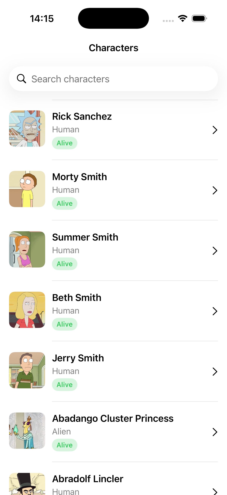

# Rick and Morty iOS

A SwiftUI application consuming the public
[Rick and Morty API](https://rickandmortyapi.com/documentation/), developed as a
Senior iOS technical assessment with an emphasis on testability and concurrency safety.

## Features

- Remote character search with a 300 ms debounce, cancellation of obsolete searches,
  and protection against stale responses updating the UI.
- Character results with cached image thumbnails and pagination driven by API metadata.
- Character details showing name, status, species, gender, origin and location.
- Loading, empty, error and retry states, with existing results preserved on pagination failure.
- In-memory domain caching with a configurable TTL, defaulting to 180 seconds.
- Native navigation, accessibility support and automatic Light/Dark appearance.

## Screenshots

  
  

Captured from the running app on an iPhone 17 Pro simulator in Light Mode.

## Tech stack

- iOS 17+, Swift 6 with strict concurrency, SwiftUI and Observation.
- Swift Package Manager, Swift Testing and native URLSession.
- SwiftFormat 0.64.5, SwiftLint 0.63.2 and GitHub Actions.
- No third-party runtime dependencies.

## Architecture

| Target | Responsibility | Dependencies |
| --- | --- | --- |
| Domain | Entities, repository contracts, use cases and fetch policies | Foundation |
| Data | Networking, DTO mapping, repository and in-memory caches | Domain |
| Presentation | SwiftUI views, observable ViewModels and presentation state | Domain |
| App | Entry point and dependency composition | Domain, Data, Presentation |

The three library targets live in `Packages/RickAndMortyKit`, with colocated tests.
Dependencies point toward Domain; the App is the composition root and supplies
concrete dependencies through constructor injection. Domain and Data avoid UI frameworks.
The project is configured for iOS only.

## Key technical decisions

- **Concurrency and cancellation:** MainActor-isolated ViewModels own UI state.
  Searches use cancellable tasks and generation identifiers to reject obsolete
  results. Cooperative cancellation also protects detail loading and repository operations.
- **Domain caching:** Generic actor-isolated `MemoryCache` stores search pages by
  normalized query and page, and details independently by character ID. `cacheFirst`
  returns valid entries without networking; missing or expired entries fetch automatically.
  Domain/Data also support `reloadIgnoringCache`; the UI has no manual refresh.
  Per-key generation tokens prevent older responses from replacing newer cached values.
  Failed or cancelled replacements preserve prior data and its original expiry.
  Pages expire independently, so a consistent server snapshot across pages is not guaranteed.
- **Networking and images:** URLSession requests decode Data-only DTOs into domain
  models and map infrastructure failures to domain errors, preserving cancellation.
  JSON requests bypass HTTP caching; a separate image session uses URLCache-backed
  HTTP caching. Image retention depends on cache policy and eviction and is not guaranteed.
- **Navigation and state:** Native `NavigationStack` carries character IDs. Views
  retain observable ViewModels with `@State`; detail load/retry tasks belong to SwiftUI.
  Pagination progress and errors remain separate from loaded results.
- **Deterministic testing:** Constructor injection, controlled repository/transport
  doubles and injected monotonic time test cancellation, expiration and out-of-order
  completion without real HTTP requests or timing-based sleeps.

## Getting started

Local build and test validation used Xcode 26.4. The CI workflow selects Xcode 26.4.1.

1. Open `RickAndMorty.xcodeproj` at the repository root.
2. Select the `RickAndMorty` scheme.
3. Select an available iOS Simulator.
4. Build and run with Cmd+R.

## Testing and quality

With the main `RickAndMorty` scheme selected, press Cmd+U to run all three package targets:

- **DomainTests:** use cases and policies using repository test doubles.
- **DataTests:** networking, mapping, cache hits, TTL expiration, cancellation and concurrent responses.
- **PresentationTests:** search, stale-result protection, pagination, detail states and retry.

Run `bash Scripts/check-quality.sh` with the pinned tools on PATH for SwiftFormat
and strict SwiftLint checks. Xcode builds also run an optional SwiftLint phase.
The [GitHub Actions workflow](.github/workflows/ci.yml) covers build, tests, lint
and formatting. Local validation is separate; a successful hosted CI run has not been verified.
See [AGENTS.md](AGENTS.md) for engineering conventions and detailed development commands.
